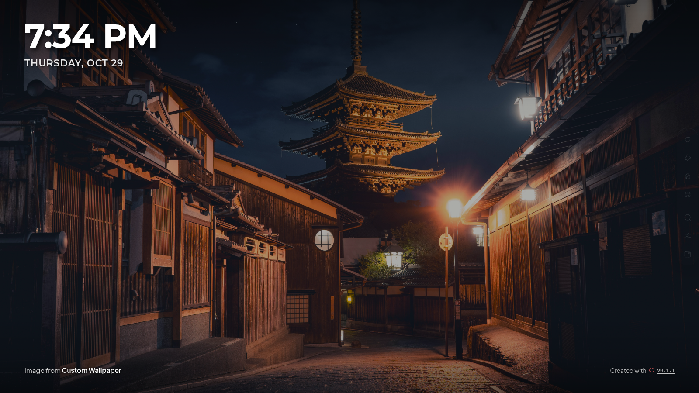
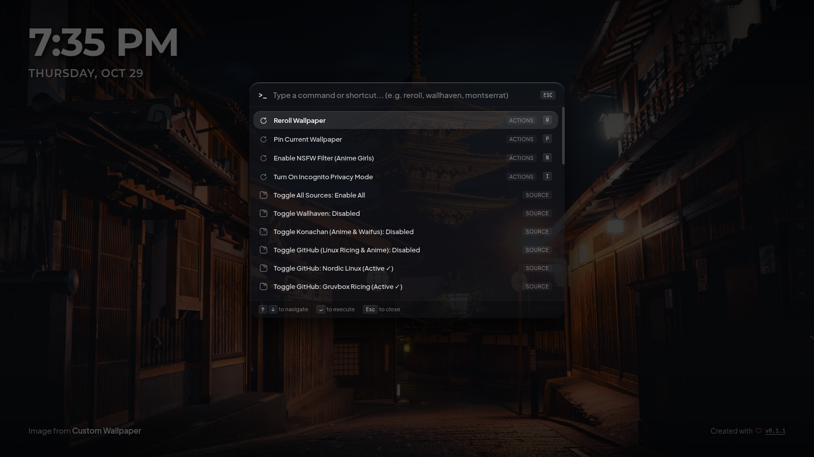
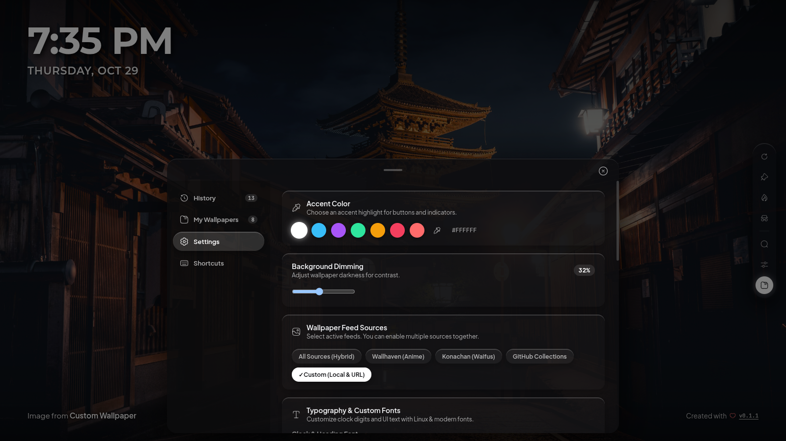
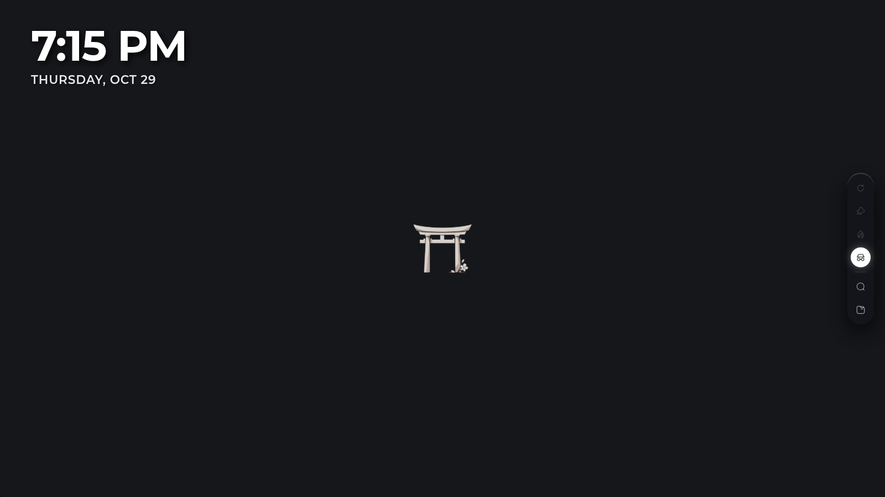

<div align="center">

  

  <h1>⛩️ Isekai Tab</h1>

  <p align="center">
    <strong>A sleek, keyboard-first anime & Linux ricing new tab extension for modern browsers.</strong>
    <br />
    <em>Every new tab transports you into an anime world with glassmorphic Waybar HUD and dark aesthetics.</em>
  </p>

  <p align="center">
    <a href="#-showcase"><b>Showcase</b></a> •
    <a href="#-highlights"><b>Features</b></a> •
    <a href="#-installation"><b>Installation</b></a> •
    <a href="#keyboard-shortcuts"><b>Shortcuts</b></a> •
    <a href="https://github.com/urstark/isekai-tab/releases"><b>Releases</b></a>
  </p>

  <div align="center">
    
    
    
  </div>

  <br />

  
  <br />
  <sub><em>Default Desktop Canvas with Waybar HUD and Solstice glassmorphism</em></sub>

</div>

<hr />

## 📸 Showcase

<div align="center" id="showcase">

<table>
  <tr>
    <td align="center" width="50%">
      
      <br />
      <sub><b>Command Palette (<kbd>Ctrl+K</kbd> / <kbd>Space</kbd>)</b></sub>
    </td>
    <td align="center" width="50%">
      
      <br />
      <sub><b>Settings Drawer & Feeds Management</b></sub>
    </td>
  </tr>
  <tr>
    <td align="center" colspan="2">
      
      <br />
      <sub><b>Minimalist Incognito Privacy Canvas (<kbd>I</kbd>)</b></sub>
    </td>
  </tr>
</table>

</div>

---

## 🌸 Highlights

* **Multi-Feed Wallpaper Engine**
  * **Wallhaven (Anime)**: Curated high-res desktop art, landscape moescape, and anime wallpapers.
  * **Konachan & Yande.re**: High-resolution Moebooru waifu & anime artwork with optional NSFW controls.
  * **GitHub Ricing Repositories**: Sub-selectable ricing collections including **Nordic Linux** (`linuxdotexe/nordic-wallpapers`), **Gruvbox Ricing** (`AngelJumbo/gruvbox-wallpapers`), **Aesthetic Anime** (`D3Ext/aesthetic-wallpapers`), and **CozyPixels** (`SleepyCatHey/CozyPixels`).
  * **Hybrid Mode**: Seamlessly shuffle across all feeds together with background replenishment.
  * **Stream Resolution Control**: Choose between **Balanced (1080p HD)** for instant ~100ms loading and ~95% bandwidth savings, or **Original (4K Ultra)** for uncompressed master artwork.

* **Waybar Quick HUD & Solstice Dock**
  * Floating edge-snapping Waybar quick rail with hover flyouts for fast source toggling.
  * Proximity-aware bottom dock with fluid blur transitions.
  * Fully customizable clock placement (Left / Center) and toggleable bottom attribution.

* **Keyboard-First Command Palette (`Ctrl+K` or `Space`)**
  * Instant Rofi / Wofi / Spotlight style modal.
  * Fast fuzzy search for wallpaper feeds, GitHub sub-collections, filters, and typeface presets without lifting your hands from the keyboard.

* **Linux Ricing Typography**
  * Choose between curated developer typefaces: **JetBrains Mono**, **Fira Code**, **Space Grotesk**, **Outfit**, **Plus Jakarta Sans**, **Poppins**, and **Montserrat**.
  * Custom font uploader: drop any local `.ttf`, `.woff`, or `.woff2` font file to style your clock and interface.

* **Offline Personal Wallpaper Hub**
  * Drag and drop local images, folder hierarchies, or direct image URLs.
  * Fast in-browser thumbnail generation and offline storage powered by IndexedDB.

* **Incognito Privacy Mode (`I`)**
  * Instantly dims the wallpaper into a clean, distraction-free static dark canvas with the centered Isekai Tab crest.

---

## 🎐 Installation

### Load in Chrome, Brave, Edge, or Chromium

1. Download `isekai-tab-chrome.zip` from the latest [Release](https://github.com/urstark/isekai-tab/releases).
2. Unzip the downloaded file into a folder of your choice.
3. Open your browser and navigate to the Extensions page:
   * Chrome: `chrome://extensions`
   * Brave: `brave://extensions`
   * Edge: `edge://extensions`
4. Toggle on **Developer mode** in the top right corner.
5. Click **Load unpacked** and select the unzipped directory.
6. Open a new tab and enjoy 🌸

### Build from Source

```bash
# Clone the repository
git clone https://github.com/urstark/isekai-tab.git
cd isekai-tab

# Install dependencies
pnpm install

# Start development server with live reload
pnpm dev

# Build production bundle
pnpm build

# Or generate distributable zip packages
pnpm zip          # Chrome MV3 (.output/isekai-tab-0.1.0-chrome.zip)
pnpm zip:firefox  # Firefox MV2 (.output/isekai-tab-0.1.0-firefox.zip)
```

---

## Keyboard Shortcuts

| Key | Action |
| :--- | :--- |
| <kbd>Space</kbd> / <kbd>Ctrl</kbd>+<kbd>K</kbd> | Open Command Palette (Rofi / Wofi style launcher) |
| <kbd>R</kbd> | Reroll wallpaper with burst animation |
| <kbd>P</kbd> | Pin current wallpaper (prevents automatic rotation) |
| <kbd>N</kbd> | Toggle NSFW filter on / off |
| <kbd>I</kbd> | Toggle Incognito privacy canvas |
| <kbd>M</kbd> | Open / close settings drawer |
| <kbd>Esc</kbd> | Close palette or settings drawer |

---

## Privacy & Philosophy

* **100% Client-Side**: No user accounts, analytics, tracking beacons, or third-party telemetries.
* **Local Storage First**: Your history, favorites, custom images, and fonts live entirely inside your browser's `localStorage` and `IndexedDB`.
* **Zero Bloat**: Fast startup with asynchronous background preloading so new tabs open instantly.

---

## Contributing

Contributions of all kinds are welcome! Check out the [Contributing Guide](CONTRIBUTING.md) to set up your local environment and view our [Code of Conduct](CODE_OF_CONDUCT.md).

---

## 🎋 License

Distributed under the [GPL-3.0-or-later](LICENSE) License.